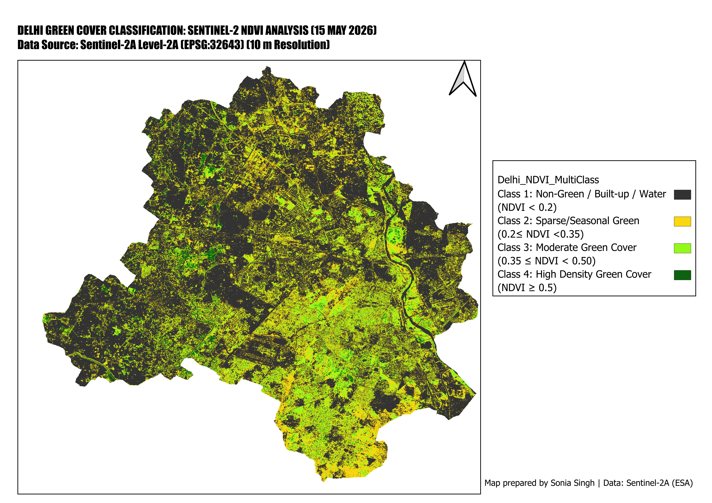

# Delhi_NDVI_Analysis
Spatial analysis and vegetation density mapping of Delhi (NCT) using Sentinel-2 multispectral imagery in QGIS. Features automated NDVI calculation, 4-tier land cover reclassification, area statistics via raster unique values, and publication-ready cartographic layout designs for environmental research.
# Spatial Analysis of Vegetation Density in Delhi (Sentinel-2)

## Overview
Spatial analysis and land cover reclassification of the National Capital Territory (NCT) of Delhi using Sentinel-2 multispectral imagery in QGIS.

## Dataset & Metadata
- **Data Source:** European Space Agency (ESA) Sentinel-2 MSI (Level-2A Bottom-Of-Atmosphere reflectance)
- **Acquisition Date:** 15 May 2026
- **Bands Used:** Band 4 (Red) & Band 8 (Near-Infrared / NIR)
- **Spatial Resolution:** 10 meters

## Workflow & Methodology
1. **Data Acquisition:** Sentinel-2 imagery (Bands 4 & 8).
2. **Pre-processing:** Mosaiced tiles and clipped to Delhi administrative boundary.
3. **Index Calculation:** Calculated NDVI = (Band 8 - Band 4) / (Band 8 + Band 4).
4. **Reclassification:** Categorized vegetation into 4 density classes.
   - **Class 1 (< 0.20):** Non-vegetation / Built-up / Water
   - **Class 2 (0.20 – 0.35):** Seasonal / Sparse Green
   - **Class 3 (0.35 – 0.50):** Moderate Green Cover
   - **Class 4 (≥ 0.50):** High Density Green Cover
5. **Area Statistics:** Extracted pixel counts using Raster Layer Unique Values for area mapping.

## Output Map Layout

## Attribute Statistics & Data Calculation

## Data Availability
DOI link: Zenodo (https://doi.org/10.5281/zenodo.23526806).

## Disclaimer
This is an independent exploratory analysis created as part of learning QGIS and remote sensing workflows. Since this is an initial work by a beginner, there may be oversights or methodological limitations. Feedback, corrections, and suggestions for improvement are most welcome! Feel free to open an issue or submit a pull request.
